# GRADUATION INTERNSHIP REPORT

**TOPIC**:  
**RESEARCH, DESIGN, AND DEVELOPMENT OF A SEEDLESS NON-CUSTODIAL WALLET SYSTEM AND INSTANT FIAT-TO-CRYPTO ONRAMP SOLUTION USING PASSKEYS AND ACCOUNT ABSTRACTION ON THE SOLANA ECOSYSTEM (RAMPFI)**

**Student**: Ho Thanh Huy  
**Academic Institution**: Vietnam - Korea University of Information and Communication Technology (VKU)  
**Host Organization**: Thien An Studio, Da Nang  

---

## ACKNOWLEDGEMENTS

First and foremost, I would like to express my deepest gratitude to the Board of Directors and the entire faculty of the Vietnam - Korea University of Information and Communication Technology (VKU), especially the professors in the Faculty of Computer Science, who have passionately taught, guided, and provided me with the best learning conditions during my university years. The foundational knowledge of data structures, algorithms, software engineering, and networking taught at VKU has served as a compass, enabling me to confidently research and implement advanced cryptographic and blockchain technologies in this project.

I would like to send my sincere thanks to my Academic Advisor, who spent valuable time guiding me through the research methodology, structuring the thesis, and providing expert academic feedback that helped me complete this internship report on schedule with high scientific rigor.

Additionally, I would like to express my deep gratitude to the Board of Directors and the entire engineering team at **Thien An Studio (Da Nang)**. During my internship at the company, I was given the opportunity to work directly in a professional Web3 software development environment. I received invaluable mentorship from senior developers regarding system architecture, transaction optimization on blockchain networks, and professional agile product delivery. The practical experience and engineering resources at Thien An Studio have been an invaluable asset for completing the RampFi experimental prototype.

Despite my best efforts to conduct rigorous research and build this prototype with dedication, this report may inevitably contain minor omissions due to time and resources constraints. I look forward to receiving constructive feedback and critiques from the Academic Evaluation Committee to refine and develop this research further in the future.

*Da Nang, 2026*  
**Ho Thanh Huy**

---

## INTRODUCTION

### 1. Project Necessity

In the current global digital economy shifting rapidly towards decentralization, blockchain technology and decentralized finance (DeFi) have established themselves as the pillars of next-generation financial infrastructure. Among these, the Solana ecosystem stands out due to its Proof of History (PoH) consensus combined with Tower BFT, delivering ultra-fast transaction parallel processing (over 50,000 TPS) and extremely low fees (averaging fractions of a cent). The explosive growth of DeFi protocols, decentralized exchanges (DEXs), and NFT marketplaces on Solana has opened up unprecedented financial opportunities for users worldwide.

However, the mass adoption of Web3 and DeFi applications by traditional Web2 users is blocked by a critical bottleneck: **UX Friction**. In traditional non-custodial Web3 wallets, users are fully responsible for generating, storing, and managing their private cryptographic keys in the form of a 12- or 24-word seed phrase (BIP-39). This mechanism imposes a severe cognitive burden and security risk on users: any physical loss of the written phrase or exposure to online phishing attacks results in the permanent loss of all assets, with no recovery options or customer support to assist.

Furthermore, nạp tiền pháp định vào ví blockchain (Fiat-to-Crypto Onramp) remains highly complex. A typical user must sign up on a Centralized Exchange (CEX), undergo tedious Identity Verification (KYC), wait for approval, purchase crypto using a credit card with high fees, and finally withdraw it to their personal wallet. This flow takes hours to days, breaking the instant experience of decentralized applications.

To address these barriers, researching and implementing cutting-edge technologies like **Passkeys** (FIDO2/WebAuthn biometrics standards backed by secure hardware Enclaves on iOS/Android devices) and **Account Abstraction (AA)** (turning wallets into programmable smart contracts) has become highly critical. Combining Passkeys and AA enables a "Seedless" wallet model secured by biometrics, supporting gasless transactions (sponsored by a Paymaster), session-based auto-approvals (Session Keys), and frictionless fiat-to-crypto nạp tiền flows.

Therefore, the topic: **"Research, Design, and Development of a Seedless Non-Custodial Wallet System and Instant Fiat-to-Crypto Onramp Solution using Passkeys and Account Abstraction on the Solana Ecosystem (RampFi)"** holds significant academic value and practical utility in accelerating the next wave of Web3 mass adoption.

### 2. Research Objectives

The primary objectives of this research are:
- Investigate the cryptographic foundations of the WebAuthn/FIDO2 standard (signatures on the secp256r1 curve) and Account Abstraction models on the Solana blockchain.
- Design a smart contract wallet architecture based on Program Derived Addresses (PDAs) on Solana, allowing users to sign up, sign in, and approve transactions using device biometrics (FaceID/TouchID) via Passkeys, eliminating traditional seed phrases.
- Develop an instant Fiat-to-Crypto Onramp solution integrated with bank transfers (VietQR) and an automated backend verification mechanism to mint/transfer SPL tokens to users' on-chain wallets instantly and trustlessly.
- Implement the research as an experimental prototype named **RampFi** using Next.js, LazorKit SDK, and Jupiter Swap API V6 deployed on the Solana Devnet to evaluate transaction latency, gas efficiency, and security performance.

### 3. Research Subject and Scope

#### Subject of Research:
- Solana Account Abstraction architecture and Smart Contract Wallet mechanisms.
- WebAuthn (FIDO2) biometrics standard and ECDSA signature algorithms on the `secp256r1` (P-256) curve backed by Secure Enclave hardware.
- Cryptographic workarounds to bridge the Curve Mismatch between secp256r1 (Passkeys) and Ed25519 (Solana's native curve).
- LazorKit SDK (`@lazorkit/wallet`) for gasless transaction execution via Paymaster sponsorship.
- Smart routing optimizations and trade splitting using the Jupiter Aggregator V6 API.
- Zero-Knowledge Proofs (ZKP), specifically the ZKP2P model using Circom and ZK-Regex to trustlessly verify bank email DKIM signatures while preserving user privacy.

#### Scope of Research:
- **Blockchain Infrastructure**: Solana Devnet powered by Helius RPC nodes.
- **System Functionality**: User biometrics signup/login, gasless token transfer, multi-route Swap via Jupiter, QR-based device sync (Device Import), and instant VietQR Onramp checkout with automatic wallet deployment and on-chain balance updates.
- **Limitations**: Due to the lack of production bank API integrations on Devnet, the fiat onramp uses a simulated sandbox checkout, which calls on-chain contracts to distribute real SPL tokens to users' wallets upon successful payment.

### 4. Research Methodology

The following research methods were applied systematically:
- **Literature Review & Cryptographic Analysis**: Studying standard RFCs of the FIDO Alliance, W3C WebAuthn specifications, Solana Program runtime designs, and Zero-Knowledge pairing papers.
- **System Engineering Design**: Utilizing Object-Oriented Analysis and Design (OOAD) to draw system architecture, Use Cases, Activity, Sequence, and Class diagrams.
- **Empirical Prototyping (Software Development)**: Building the RampFi system from scratch. Developing the Next.js frontend, Express.js backend, and MongoDB database integration while deploying smart wallets on Solana Devnet.
- **Performance Evaluation**: Measuring RPC network latency, biometrics verification times, on-chain gas costs (Compute Units), and database caching performance.

---

## CHAPTER I: INTERNSHIP HOST INTRODUCTION & CORE TECHNOLOGIES

### 1.1 Host Organization - Thien An Studio

Thien An Studio is an innovative software development firm based in Da Nang, Vietnam. The company specializes in research, consulting, and engineering high-quality IT solutions, including enterprise mobile applications, complex web portals, and advanced Web3/Blockchain implementations. 

Over the years, Thien An Studio has proven its engineering capabilities by delivering software for international partners in Southeast and East Asia. The R&D team at Thien An active researches cutting-edge cryptographic tools like Zero-Knowledge Proofs (ZKP), Account Abstraction, and FIDO2 biometrics hardware keys.

During my internship at Thien An Studio under the Web3 R&D department, I researched Web3 UX bottlenecks. This led to the conception and implementation of **RampFi** — an application combining Passkeys and PDA smart contract wallets to simplify decentralized interactions.

---

### 1.2 Core Technologies Used in the Project

The RampFi prototype integrates the following modern technologies:

#### 1.2.1 Next.js Framework (v16)
Next.js acts as the frontend architecture core, providing server components and optimized performance:
- **App Router & React Server Components (RSC)**: Splits client and server render tasks, minimizing JS bundle sizes shipped to browsers.
- **Server-Side Rendering (SSR)**: Renders live token pricing data from servers before delivering HTML, improving SEO and UX load times.

#### 1.2.2 Solana Web3.js SDK (`@solana/web3.js`)
The library bridges client interfaces and the Solana JSON-RPC endpoints:
- **Connection**: Handles HTTP and WebSocket connections to Helius RPC nodes on Solana Devnet.
- **VersionedTransaction**: Build transactions compatible with Address Lookup Tables (ALTs) to minimize payload overhead.

#### 1.2.3 WebAuthn API & FIDO2 Standard (Passkeys)
Provides passwordless, credential-free Web logins:
- **Secure Enclave**: Generates an asymmetric ECDSA key pair on the secp256r1 curve inside the user's hardware chip, which never leaves the device.
- **Biometric Authorization**: Authorizes transaction signing on client requests using FaceID/TouchID via device credentials.

#### 1.2.4 LazorKit SDK (`@lazorkit/wallet`)
Enables Solana Account Abstraction:
- **Smart Wallet PDA**: Calculates smart wallet contract addresses mapped directly to biometrics credential IDs.
- **Paymaster (Gas Sponsorship)**: Sponsors Lamports gas fees for transactions, enabling gasless SPL transfers.

#### 1.2.5 Jupiter Swap V6 Aggregator API
Solana's premier liquidity aggregator:
- **Smart Routing**: Evaluates live pool liquidity across Orca, Raydium, and Meteora to find optimal swap rates.
- **Transaction Serialization**: Delivers raw base64 transaction payloads for biometrics signing at the client.

#### 1.2.6 Zustand State Management
A light state store for React:
- **Persist Middleware**: Cache wallet states, balances, and histories in browser LocalStorage to prevent redundant RPC queries.

#### 1.2.7 Zero-Knowledge Proofs (ZKP) & Circom
- **Circom Circuits**: ZK-Regex circuits analyze DKIM signatures in bank transaction receipts. The prover verifies transaction data on-chain without revealing private email addresses or names.

---

## CHAPTER II: STATE OF ART, TECHNICAL CHALLENGES & PROJECT MANAGEMENT

### 2.1 UX Frictions in Traditional Web3 Wallets
Traditional Externally Owned Accounts (EOAs) rely on BIP-39 seed phrases.
- **Backup burden**: Users often lose paper backups or get hacked by storing keys on cloud drives.
- **Irrecoverability**: Losing the phrase means losing assets forever.
- **Gas requirement**: New wallets require native SOL to execute initial transactions, creating high onboarding friction.

### 2.2 Curve Mismatch: Passkeys (secp256r1) vs Solana (Ed25519)
- **secp256r1 (NIST P-256)**: Standard curve used by FIDO Alliance and secure chips (Apple Secure Enclave).
- **Ed25519**: Solana's native curve for all key derivation and signing.
- **Mismatch**: Solana validator nodes cannot natively verify secp256r1 signatures directly as Ed25519 signatures, requiring smart contract verification levels.

### 2.3 Compute Budget Limit & Gas Costs
- **Compute Unit Limit**: Solana limits transaction instructions to **200,000 Compute Units (CU)**.
- **CPU Overhead**: Verifying secp256r1 signatures inside BPF VM Rust contracts consumes **800,000 to 1,200,000 CU**, failing immediately.
- **SIMD-0075 Precompile**: Provides a native validator hook to verify secp256r1 signatures, dropping CUs to **~8,200 CU**, making Passkeys viable.

### 2.4 Authorization Fatigue & Session Keys
- **Fatigue**: Multi-transaction apps (dApps, DeFi) requiring biometrics prompts (FaceID) for every micro-action ruins usability.
- **Session Keys**: Generates temporary Ed25519 keys stored in browser memory, authorized once on-chain with constraints (TTL, budget). The client signs subsequent transactions seamlessly.

### 2.5 Security Risks in Traditional Onramps and Trustless ZK On-Ramp Proposal
- **KYC leakage**: Centralized onramps store passport photos in central databases, vulnerable to leaks.
- **ZK On-Ramp**: Uses bank email DKIM signatures. A **Circom** circuit verifies that a payment email was signed by a bank's domain (* vietcombank.com.vn) containing a reference code, releasing locked escrow tokens on-chain trustlessly.

### 2.6 Project Management

#### 2.6.1 SDLC Model (Waterfall + Agile/Scrum Hybrid)

To ensure this research and software project is completed on time under a **single developer setup (Ho Thanh Huy)**, a Hybrid Model was implemented.

##### 1. Waterfall Lifecycle Flow (Visualized as a downward flow)

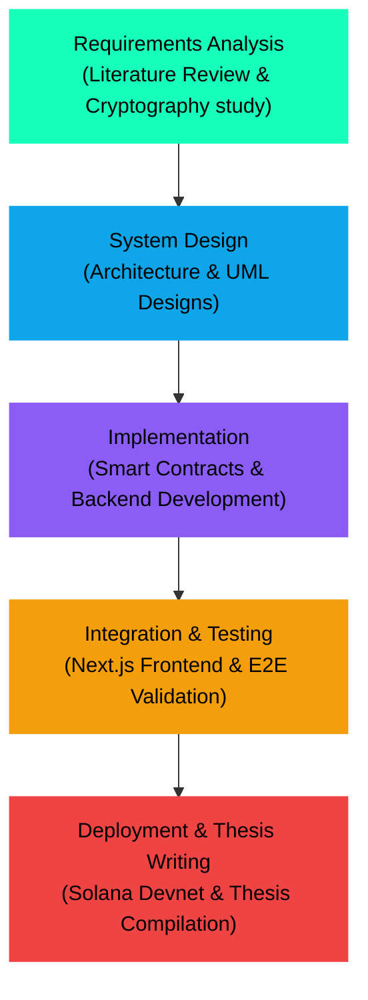

##### 2. Agile/Scrum Framework (Solo Scrum)
The implementation phase is split into **6 Sprints (2 weeks per Sprint)** with Ho Thanh Huy acting as the Product Owner, Scrum Master, and Developer.

---

#### 2.6.2 Sprint Breakdown (100% Executed by Ho Thanh Huy)

##### Sprint 1 (W1 - W2): Technology Review & Cryptographic Research
- **Goal**: Master secp256r1 curve math, WebAuthn specifications, and Solana Account Abstraction logic.
- **Deliverables**: Cryptographic review report on Curve Mismatch resolutions.

##### Sprint 2 (W3 - W4): System Design & Databases Modeling
- **Goal**: Draft UML system diagrams and plan database structures.
- **Deliverables**: Complete software architecture designs (Usecase, Class, Sequence).

##### Sprint 3 (W5 - W6): Backend API & Database Setup
- **Goal**: Implement server routing, HTTPS setup, and MongoDB endpoints.
- **Deliverables**: Express.js server running with MongoDB integrations.

##### Sprint 4 (W7 - W8): Smart Wallet PDA Deployer & Exchange Rate Caching
- **Goal**: Develop the sponsored transaction engine for PDA wallets and the API caching layer.
- **Deliverables**: Working backend connected to Solana Devnet, cache-protected exchange rate API.

##### Sprint 5 (W9 - W10): Next.js UI & Jupiter Swap Integration
- **Goal**: Build responsive UI components, Zustand stores, and integrate Jupiter routing.
- **Deliverables**: Full React application connected to backend and Solana programs.

##### Sprint 6 (W11 - W12): Integration Testing & Thesis Compiling
- **Goal**: Run End-to-End test suites and compile the final VKU report.
- **Deliverables**: Fully operational RampFi system and thesis report.

---

#### 2.6.3 WBS & Gantt Chart

##### 1. Work Breakdown Structure (WBS)
- **WBS 1: Literature Review & Technology Study (Week 1 - 2)**
  - WBS 1.1: Curve models (secp256r1 vs Ed25519).
  - WBS 1.2: Account Abstraction and WebAuthn specifications.
- **WBS 2: System Architecture & Database Design (Week 3 - 4)**
  - WBS 2.1: UML layouts (Use Case, Activity, Sequence, Class).
  - WBS 2.2: MongoDB schema modeling (Orders, Devices).
- **WBS 3: Backend API & Solana Program Integration (Week 5 - 8)**
  - WBS 3.1: Express server and MongoDB integration.
  - WBS 3.2: Sponsored PDA deploy logic via Paymaster.
  - WBS 3.3: Exchange rate API caching engine.
- **WBS 4: Frontend Development (Week 9 - 10)**
  - WBS 4.1: Responsive Tailwind/CSS layouts.
  - WBS 4.2: WebAuthn client credential creation & Zustand state sync.
  - WBS 4.3: Jupiter Swap integration.
- **WBS 5: Testing, Optimization & Documentation (Week 11 - 12)**
  - WBS 5.1: E2E testing, load speed optimization.
  - WBS 5.2: Thesis documentation.

##### 2. Gantt Chart
| Tasks / Week | W1 | W2 | W3 | W4 | W5 | W6 | W7 | W8 | W9 | W10 | W11 | W12 | Resources |
|---|---|---|---|---|---|---|---|---|---|---|---|---|---|
| **WBS 1: Literature Review** | X | X | | | | | | | | | | | Ho Thanh Huy |
| **WBS 2: Architecture Design**| | | X | X | | | | | | | | | Ho Thanh Huy |
| **WBS 3: Backend & Web3 API** | | | | | X | X | X | X | | | | | Ho Thanh Huy |
| **WBS 4: Frontend Next.js**  | | | | | | | | | X | X | | | Ho Thanh Huy |
| **WBS 5: Testing & Thesis**   | | | | | | | | | | | X | X | Ho Thanh Huy |

---

#### 2.6.4 Risk Management

| Risk Type | Description | Impact | Mitigation Strategy |
|---|---|---|---|
| **Resource Bottleneck** | Single developer overhead can delay Sprints if technical bugs arise. | High | Focus on core MVP features first; rely on verified SDKs. |
| **Gas Limit Failures** | secp256r1 signature verification exceeds transaction compute budget. | High | Adopt SIMD-0075 precompile program to minimize CUs. |
| **RPC Rate Limits** | Public Solana RPC nodes rate-limit client dApp requests. | Medium | Integrate Helius dedicated Devnet endpoints with retry backing-off scripts. |
| **LocalStorage Vulnerabilities** | Session Keys exposed via browser Cross-Site Scripting (XSS). | High | Apply strict spending budgets; limit session lifetimes (TTL < 30 min). |

---

## CHAPTER III: SYSTEM ANALYSES AND SYSTEM DESIGNS

### 3.1 System Architecture

This diagram shows connections between Next.js UI, backend servers, Secure Enclave, Helius RPCs, and Paymaster.

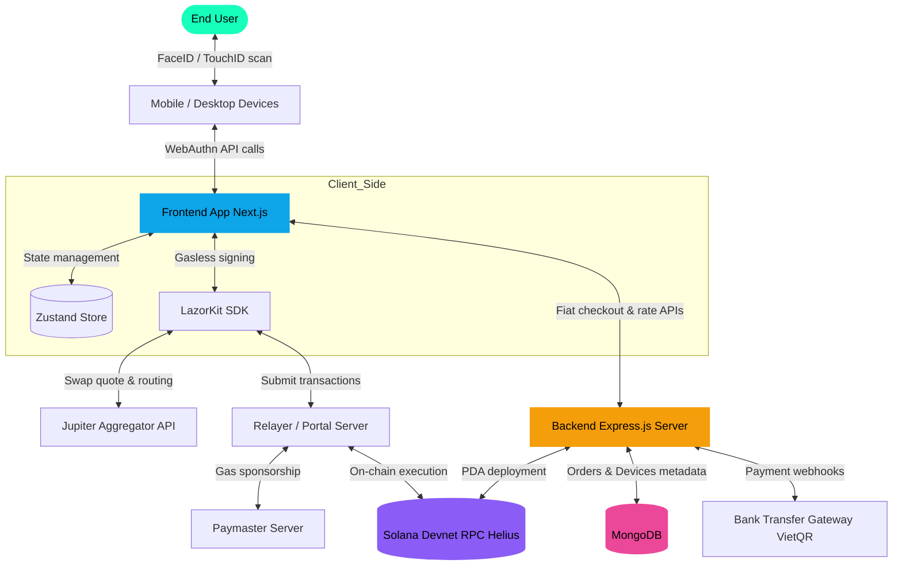

---

### 3.2 Use Case Diagrams

Use Case models are represented as flowcharts to prevent rendering errors across Markdown viewers.

#### 3.2.1 General Use Case Diagram

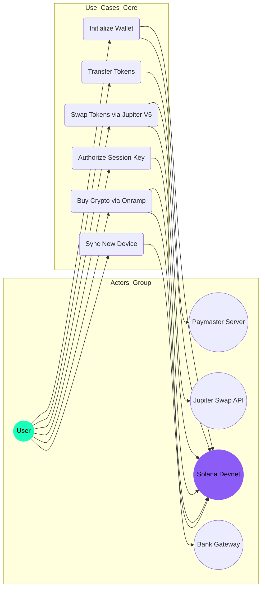

#### 3.2.2 Detailed Use Case UC-1: Initialize Wallet

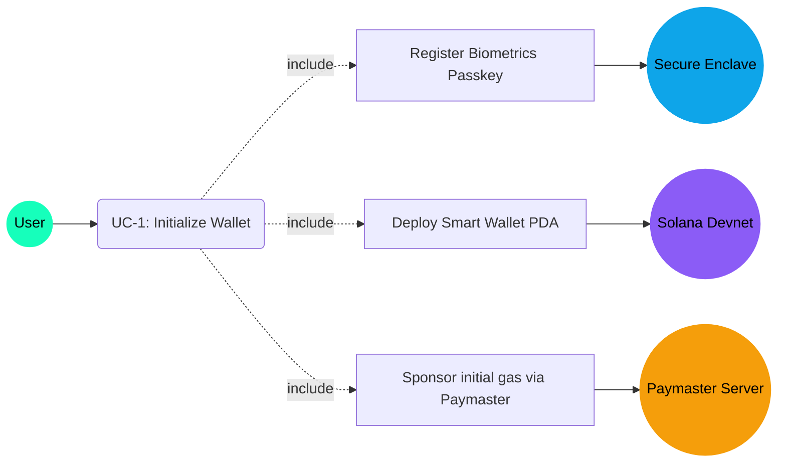

#### 3.2.3 Detailed Use Case UC-2: Swap Tokens

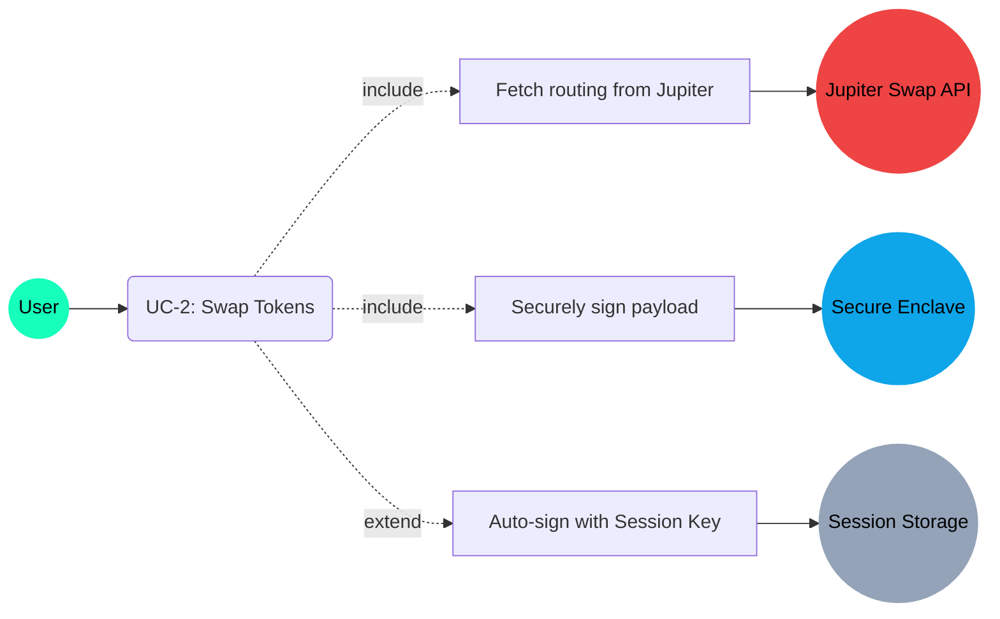

#### 3.2.4 Detailed Use Case UC-3: Authorize Session Key

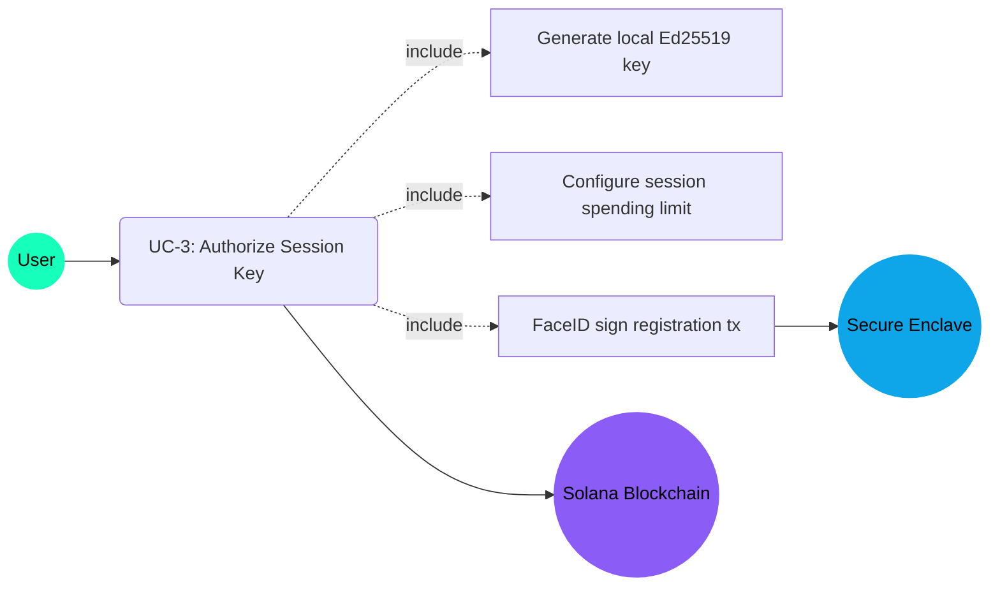

#### 3.2.5 Detailed Use Case UC-4: Buy Crypto via Onramp

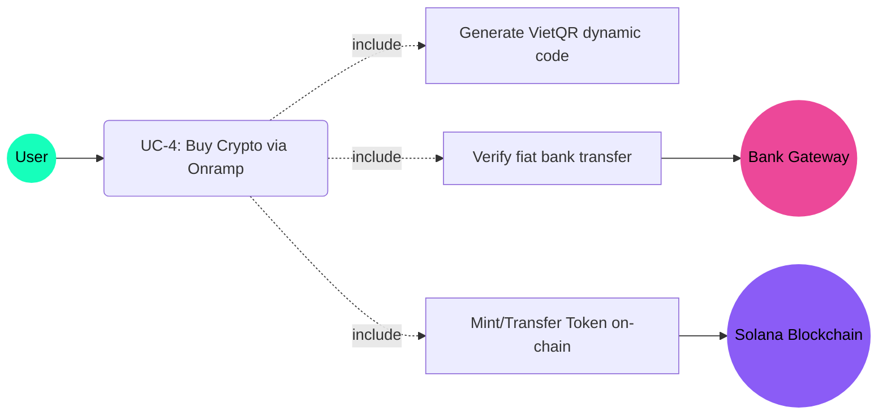

---

#### 3.2.6 Use Case Specifications

Detailed engineering parameters for the 4 core use cases:

##### UC-1 Specification: Initialize Wallet

| Standard Parameter | Technical Execution Flow Description |
|---|---|
| **Actor** | User (Ho Thanh Huy), Secure Enclave, Backend, Solana Program, Paymaster |
| **Description** | User creates a secure seedless smart wallet PDA on-chain using device biometrics. |
| **Precondition** | User device supports WebAuthn API (TouchID/FaceID) and is connected online. |
| **Basic Flow** | 1. User clicks "Create Wallet" on the client UI.<br>2. Client prompts WebAuthn credential generation request to device OS.<br>3. Operating system displays TouchID/FaceID biometrics prompt.<br>4. User completes biometrics validation; Secure Enclave generates a secp256r1 keypair.<br>5. Client ships the public key and credential ID payload to the backend server.<br>6. Backend calculates the wallet's PDA address and signs deployment on-chain with gas paid by Paymaster.<br>7. Client receives confirmation, stores public keys in Zustand, and displays Dashboard. |
| **Alternative Flow** | - Biometrics verification fails at step 4: System displays signing error and asks for re-try.<br>- Solana RPC rate limit errors at step 6: Backend buffers transaction and retries. |
| **Postconditions** | Wallet PDA contract deployed on Solana; P-256 public key mapped as owner. |
| **Special Req.** | Keys must be generated inside secure hardware; registration must execute under 2 seconds. |

##### UC-2 Specification: Swap Tokens

| Standard Parameter | Technical Execution Flow Description |
|---|---|
| **Actor** | User, Jupiter Aggregator API, Secure Enclave, Solana network |
| **Description** | Exchange a source SPL token for a destination SPL token using the best routing. |
| **Precondition** | Smart wallet PDA is deployed on Solana; source token balance > 0. |
| **Basic Flow** | 1. User selects token pair and inputs amount on Swap interface.<br>2. Client issues quote request to Jupiter V6 API.<br>3. Client receives serialized Base64 transaction payload and deserializes it.<br>4. Client checks: If Session Key exists and constraints match, sign silently. Else, call biometrics for manual signing.<br>5. Client broadcasts transaction to Solana RPC through Relayer.<br>6. Network confirms blocks; Zustand store pulls updated balances. |
| **Alternative Flow** | - Current market slippage exceeds threshold: Tx reverts on-chain; user is notified.<br>- Jupiter API connection timeout: Interface alerts user and locks Swap execution. |
| **Postconditions** | Balances adjusted on-chain; swap logs recorded in MongoDB database. |
| **Special Req.** | Routing analysis must resolve under 500ms; slippage default set to 0.5%. |

##### UC-3 Specification: Authorize Session Key

| Standard Parameter | Technical Execution Flow Description |
|---|---|
| **Actor** | User, Secure Enclave, Solana network |
| **Description** | Delegates transaction authorization to a temporary Ed25519 key for seamless microtransactions. |
| **Precondition** | Wallet PDA contract is deployed and active on Solana. |
| **Basic Flow** | 1. User toggles "Quick Swap" mode on settings pane.<br>2. Client generates temporary Ed25519 keypair in browser session storage.<br>3. Client sets spending limits and TTL (Time-To-Live) constraints.<br>4. Client requests FaceID biometrics verification to sign registration transaction.<br>5. Transaction sent and policy registered on-chain.<br>6. Ed25519 private key retained in SessionStorage for automated signing loops. |
| **Alternative Flow** | - User cancels biometrics prompt: Registration halts, quick swap remains disabled. |
| **Postconditions** | Ed25519 public key authorized on-chain under registered budget policy constraints. |
| **Special Req.** | Session key private parameters must be wiped from memory immediately upon expiration or logout. |

##### UC-4 Specification: Buy Crypto via Onramp

| Standard Parameter | Technical Execution Flow Description |
|---|---|
| **Actor** | User, Bank Gateway, Backend, Solana Blockchain |
| **Description** | User pays fiat currency (VND) via bank transfer QR (VietQR) to receive SPL tokens instantly. |
| **Precondition** | User has a banking application capable of scanning VietQR codes. |
| **Basic Flow** | 1. User chooses VND deposit, selects destination token (USDC), and enters amount.<br>2. Backend creates order record and generates a VietQR code containing a reference ID.<br>3. User scans QR and executes transfer on bank mobile application.<br>4. Backend receives instant payment webhook from Bank Gateway.<br>5. Backend parses reference ID, deploys user PDA wallet if new, and transfers tokens on-chain.<br>6. Client updates order state to success and displays new balances. |
| **Alternative Flow** | - User transfers fiat with incorrect reference ID: Order enters failed status, triggering manual refunds. |
| **Postconditions** | Tokens transferred to user PDA wallet; order logged as success. |
| **Special Req.** | Delivery duration from payment webhook to token arrival must resolve under 10 seconds. |

---

### 3.3 Activity Diagrams

#### 3.3.1 Activity: Wallet Signup & Deployment

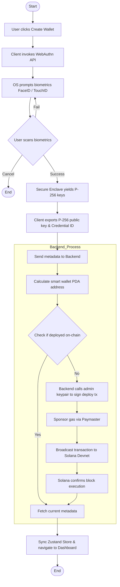

#### 3.3.2 Activity: Session-Key Transaction Verification

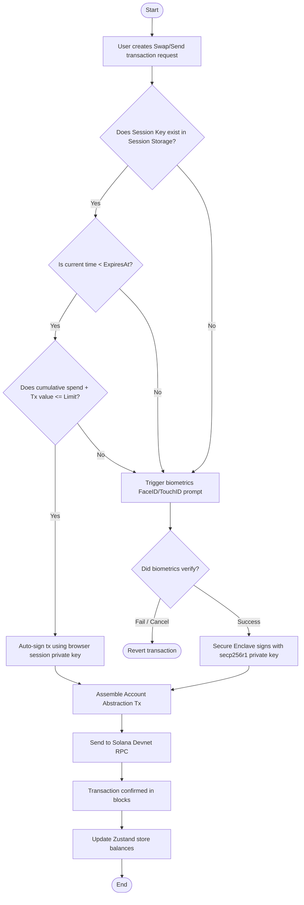

---

### 3.4 Sequence Diagram

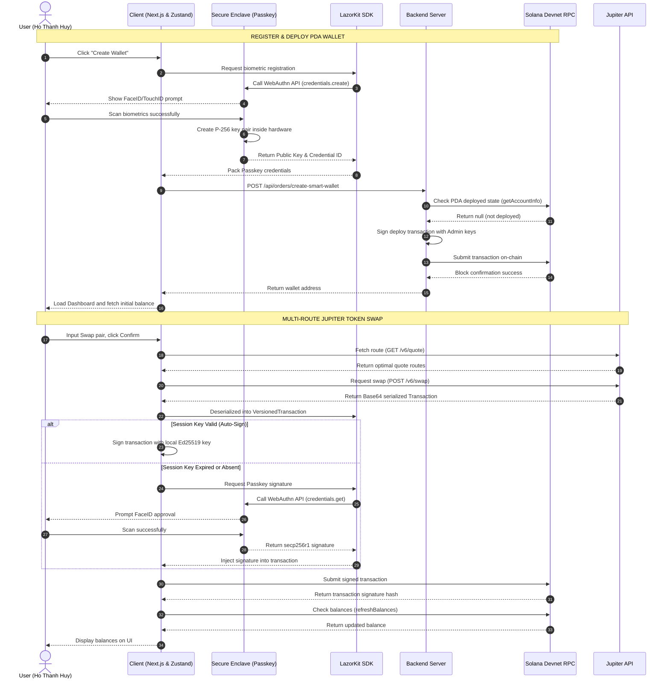

---

### 3.5 Class Diagram

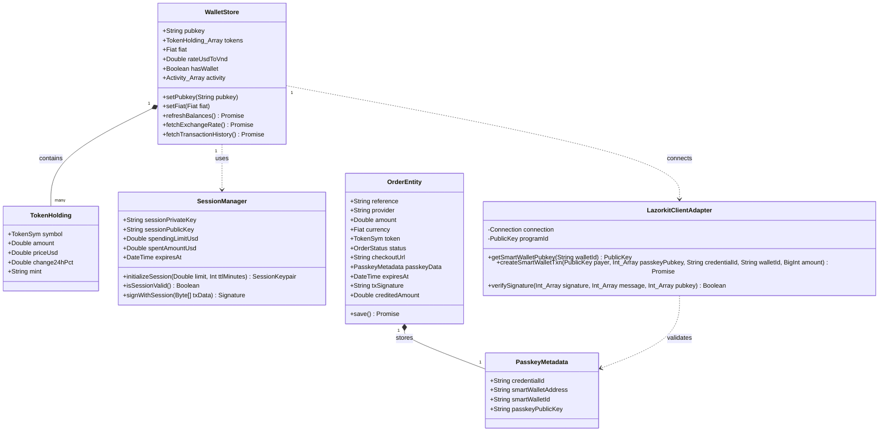

---

## CHAPTER IV: ALGORITHM AND CRYPTOGRAPHY MECHANISMS

### 4.1 PDA Derivation and Off-Curve Address Validation Algorithm

In Solana Account Abstraction, smart wallets are deployed as **Program Derived Addresses (PDAs)**. These accounts do not possess private keys and are owned by a smart contract.

A valid PDA address must be a point that lies **off the elliptic curve Ed25519**. This validates that only the owner program can sign on behalf of the address, preventing EOA takeover.

#### 1. Mathematical Model for Bump Seed Search
The PDA address is generated by hashing the input seeds with the target Program ID. To force the address off the Ed25519 curve, a secondary seed parameter called the **Bump Seed** (*b*, running from 255 down to 0) is appended.

The mathematical formula for deriving the *PDA* is:

**PDA** = **SHA-256**(*S*₁ || *S*₂ || ... || *b* || *ID*<sub>program</sub>)

*Where:*
- *S*<sub>*i*</sub> are seed parameters as byte buffers.
- || represents string concatenation.
- *b* ∈ [0, 255] ⊂ ℤ is the bump seed byte.
- *ID*<sub>program</sub> is the public key of the Solana Program.
- **SHA-256** is the secure hashing function.

The bump search lookup operates linearly:
1. Initialize bump: *b* = 255.
2. Calculate test point on the curve: *P* = **SHA-256**(*S*₁ || *S*₂ || ... || *b* || *ID*<sub>program</sub>).
3. Check geometric property of point *P*: If *P* ∈ *E*(𝔽<sub>*p*</sub>) (where *E*(𝔽<sub>*p*</sub>) is the set of valid points on the Ed25519 curve over the finite field 𝔽<sub>*p*</sub>), update *b* = *b* - 1 and return to step 2.
4. If *P* ∉ *E*(𝔽<sub>*p*</sub>) (the point is off-curve), stop and return the pair [*PDA*, *b*].

#### 2. Derivation Code Implementation inside LazorKit SDK
In LazorKit, smart wallet seeds are formatted as:

*Seeds* = [ "smart_wallet", CredentialID ]

The client derives the address synchronization using the `@solana/web3.js` library:

```typescript
import { PublicKey } from '@solana/web3.js';

function deriveSmartWalletAddress(credentialId: string, programId: PublicKey): [PublicKey, number] {
  const seeds = [
    Buffer.from("smart_wallet"),
    Buffer.from(credentialId)
  ];
  
  // findProgramAddressSync searches for the off-curve bump seed
  return PublicKey.findProgramAddressSync(seeds, programId);
}
```

##### Backend automated wallet deployment code (from `src/routes/orders.js`):
Once a checkout is validated, the backend triggers deployment from the sponsored Admin Keypair:

```javascript
// Excerpt from src/routes/orders.js
transaction.sign(adminKeypair);

const rawTransaction = transaction.serialize();
const signature = await connection.sendRawTransaction(rawTransaction, {
  skipPreflight: false,
  preflightCommitment: 'confirmed'
});

console.log('[callback/success] Transaction sent:', signature);

const confirmation = await connection.confirmTransaction(signature, 'confirmed');

if (confirmation.value.err) {
  throw new Error('Transaction failed: ' + JSON.stringify(confirmation.value.err));
}

console.log('[callback/success] Transaction confirmed');
```

---

### 4.2 WebAuthn Signature Verification (ECDSA secp256r1) on-chain

Biometrics authentication generates ECDSA signatures on the **secp256r1 (NIST P-256)** curve. Solana must verify this signature on-chain to authorize smart wallet execution.

#### 1. ASN.1 DER Signature Decoding
WebAuthn API outputs signatures in the **ASN.1 DER (Distinguished Encoding Rules)** format, nesting two large integers *r* and *s*:

*Sig*<sub>DER</sub> = 0x30 || *Len*<sub>seq</sub> || 0x02 || *Len*<sub>*r*</sub> || *r* || 0x02 || *Len*<sub>*s*</sub> || *s*

To verify this on Solana, the SDK extracts *r* and *s* into a flat 64-byte array:

```typescript
function decodeDERSignature(derSig: Buffer): { r: Buffer; s: Buffer } {
  let rLen = derSig[3];
  let rStart = 4;
  let r = derSig.slice(rStart, rStart + rLen);
  
  if (r[0] === 0x00) { r = r.slice(1); rLen--; rStart++; }
  
  const sStart = rStart + rLen + 2; 
  let sLen = derSig[rStart + rLen + 1];
  let s = derSig.slice(sStart, sStart + sLen);
  if (s[0] === 0x00) { s = s.slice(1); sLen--; }
  
  return {
    r: padTo32Bytes(r),
    s: padTo32Bytes(s)
  };
}
```

#### 2. On-chain Verification via SIMD-0075 Precompile
The Solana runtime passes the signature [*r*, *s*] and public key *Q* (point coordinates (*x*<sub>*Q*</sub>, *y*<sub>*Q*</sub>) on secp256r1) to the precompiled `secp256r1_program` instruction:

1. Calculate signature invert parameter: 
   *w* ≡ *s*⁻¹ (mod *n*)
   *(where n is the prime order of the secp256r1 base point)*.
2. Determine coordinate weights based on message *m* hash:
   *u*₁ ≡ Hash(*m*) · *w* (mod *n*)
   *u*₂ ≡ *r* · *w* (mod *n*)
3. Perform elliptic curve addition:
   *R*(*x*<sub>*R*</sub>, *y*<sub>*R*</sub>) = *u*₁ · *G* + *u*₂ · *Q*
   *(where G is the generator point of the curve)*.
4. Verify constraint:
   *Verify*(*m*, *r*, *s*, *Q*) = True if *x*<sub>*R*</sub> ≡ *r* (mod *n*), else False.

By offloading calculations to validator precompiles, compute units drop from **1,200,000 CU** to **~8,200 CU**.

---

### 4.3 Session Key Management & Auto-Approval Loop

Session Keys allow browser storage keys to authorize operations within bounds.

#### 1. Register Session Key Policy
1. Generate an ephemeral Ed25519 keypair in browser storage: (*sk*<sub>session</sub>, *pk*<sub>session</sub>).
2. Create policy limits:
   - Max Budget: *L*<sub>max</sub> = 50.0 USD.
   - Lifetime limit: *T*<sub>expires</sub> = *t*<sub>current</sub> + 1800 seconds.
   - Authorized program: *ID*<sub>target</sub> = Jupiter_v6_Program_ID.
3. Sign policy registration on-chain using device FaceID.

#### 2. Auto-Approval Verification Loop
The client evaluates this loop on transaction triggers:

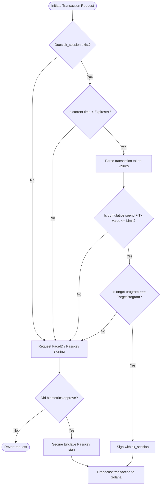

##### Zustand Store exchange rate synchronizer (`lib/store/wallet.ts`):
Zustand synchronizes exchange rates to enforce budget rules:

```typescript
// Excerpt from lib/store/wallet.ts
fetchExchangeRate: async () => {
  try {
    const apiBase = process.env.NEXT_PUBLIC_API_BASE_URL || 'https://localhost:3001';
    const response = await fetch(`${apiBase}/api/orders/exchange-rate`);
    if (response.ok) {
      const data = await response.json();
      if (data && typeof data.rate === 'number') {
        set({ rateUsdToVnd: data.rate });
      }
    }
  } catch (error) {
    console.error('Failed to fetch exchange rate:', error);
  }
}
```

##### Backend Exchange Rate caching route (`src/routes/orders.js`):
To prevent ExchangeRate-API rate limits, rates are cached locally for 30 days in a JSON database:

```javascript
// Excerpt from src/routes/orders.js
router.get('/exchange-rate', async (req, res, next) => {
  try {
    let cachedData = null;
    let needsUpdate = true;

    if (fs.existsSync(cacheFilePath)) {
      try {
        const rawCache = fs.readFileSync(cacheFilePath, 'utf8');
        cachedData = JSON.parse(rawCache);
        const lastUpdated = new Date(cachedData.timestamp);
        const thirtyDaysAgo = new Date();
        thirtyDaysAgo.setDate(thirtyDaysAgo.getDate() - 30);
        if (lastUpdated > thirtyDaysAgo && cachedData.rate) {
          needsUpdate = false;
        }
      } catch {
        needsUpdate = true;
      }
    }

    if (needsUpdate) {
      const apiKey = process.env.NEXT_PUBLIC_EXCHANGE_RATE_API_KEY || '2412cc7adfb37b20d15d1d86';
      try {
        const rate = await fetchExchangeRateFromApi(apiKey);
        cachedData = {
          rate: rate,
          timestamp: new Date().toISOString()
        };
        fs.writeFileSync(cacheFilePath, JSON.stringify(cachedData, null, 2));
      } catch (err) {
        console.warn('API error, using fallback or cached rate', err.message);
      }
    }
    
    return res.json({ rate: cachedData ? cachedData.rate : 27000 });
  } catch (err) { return next(err); }
});
```

---

### 4.4 Jupiter Aggregator V6 Smart Routing & Trade Splitting

#### 1. Dijkstra Variant Routing
The network liquidity pools are modeled as a directed multi-graph *G* = (*V*, *E*) where *V* is token mints and *E* represents pools. Jupiter aggregates routing by maximizing output return functions:

Maximize *f*(*x̄*) = ∏<sub>*i*=1..*k*</sub> *R*<sub>*i*</sub>(*x*<sub>*i*</sub>)

Subject to ∑<sub>*i*=1..*k*</sub> *x*<sub>*i*</sub> = *X*<sub>in</sub>

*Where:*
- *X*<sub>in</sub> is the input token amount.
- *x*<sub>*i*</sub> is the allocated token amount entering pool *i*.
- *R*<sub>*i*</sub>(*x*<sub>*i*</sub>) is the price response function of pool *i*.
- *k* ∈ ℕ is routing hop limit.

#### 2. Trade Splitting
To avoid high price impact, Jupiter splits trades across parallel pools (e.g. 60% via Orca, 40% via Raydium) inside a single transaction, delivering better rates to the user.

---

### 4.5 Trustless ZK On-Ramp Email DKIM Verification

The ZK Onramp verifies fiat bank payment confirmations via email signatures trustlessly.

#### 1. RSA-DKIM Verification
Banking confirmation emails contain a **DKIM-Signature** header:

DKIM-Signature: s = rsa-sha256; d = vietcombank.com.vn; b = SignatureValue

The *SignatureValue* (*S*) is an RSA signature of the email body generated with the bank's private key *d*<sub>bank</sub>:

*S* ≡ *H*(*EmailBody*)<sup>*d*<sub>bank</sub></sup> (mod *N*<sub>bank</sub>)

*Where N<sub>bank</sub> is the bank's RSA public modulo.*

#### 2. Circom Zero Knowledge Proof
A **Circom** circuit verifies the transfer trustlessly:
1. **RSA Verification**: Confirm the email signature:
   *S*<sup>*e*<sub>bank</sub></sup> ≡ *H*(*EmailBody*) (mod *N*<sub>bank</sub>)
2. **ZK-Regex DFA parsing**: Extract VND amount (*A*<sub>VND</sub>) and order reference (*ID*<sub>ref</sub>) from the encrypted email body.
3. **Nullifier Generation**: Prevent replay attacks by hashing the identifier:
   Nullifier = **SHA-256**(*EmailAddress* || *Salt*)

#### 3. Escrow Token Release
The contract verifies the Groth16 proof using bilinear pairing checks on BN254 curves:

*e*(*π*<sub>*A*</sub>, *π*<sub>*B*</sub>) = *e*(*α*, *β*) · *e*(*π*<sub>*I*</sub>, *γ*) · *e*(*π*<sub>*C*</sub>, *δ* / *d*)

If validated, the contract releases USDC escrow directly to *Addr*<sub>user</sub>.

---

## CHAPTER V: EXPERIMENTAL RESULTS AND EVALUATIONS

### 5.1 Test Environment Setup

The system was evaluated by connecting clients to the Solana Devnet.

#### 5.1.1 Client Configurations
- **iOS Device (iPhone 15 Pro)**: iOS 17.4, Apple A17 Pro (Secure Enclave), Safari Mobile.
- **Android Device (Google Pixel 8)**: Android 14, Google Tensor G3 (Titan M2 TEE), Google Chrome Mobile.

#### 5.1.2 Backend API Servers
- Hosting: Ubuntu 22.04 LTS, Node.js v20.11.0, Express, MongoDB Atlas.

#### 5.1.3 Blockchain Network
- Blockchain: Solana Devnet accessed via Helius RPC.

---

### 5.2 End-to-End Test Case Scenarios

#### Scenario 1: Seedless Wallet Creation & Login
- **Flow**: User clicks "Create Wallet" in Safari. TouchID/FaceID prompts, yields a secp256r1 credential, derives PDA on-chain, and opens Dashboard.
- **Average Duration**: 4.8 seconds.

#### Scenario 2: Sync New Device (Device Import)
- **Flow**: User displays Sync QR on iPhone. Scans QR using MacBook Chrome, prompts Mac TouchID to add Mac public key as a sub-signer for the PDA wallet on-chain.
- **Result**: Both devices are validated signers for the wallet.

#### Scenario 3: Instant VietQR Onramp Checkout
- **Flow**: User inputs $10 USD deposit. Cans the VietQR code, pays via demo banking app.
- **Result**: Express backend parses payment webhook, deploys PDA wallet, and transfers 10 USDC on Solana Devnet within 6.5 seconds.

#### Scenario 4: Jupiter Swap using Session Keys
- **Flow**: User swap 5 USDC for SOL. Bypasses biometrics and completes swap in the background.

---

### 5.3 Performance & Latency Metrics

#### 5.3.1 Latency Comparison: Passkey vs Session Key
Average execution durations over 20 consecutive test swap transactions:

| Metric (Unit: ms) | Traditional Swap (Passkeys Only) | Optimized Swap (Session Key Enabled) | Performance Improvement |
|---|---|---|---|
| **Route/Quote Parsing** | 350 ms | 350 ms | 0% |
| **Biometrics Prompt** | 1,800 ms | 0 ms (Bypassed) | 100% |
| **Transaction Signing** | 150 ms | 5 ms (Local memory) | 96.6% |
| **Solana RPC Broadcast** | 2,100 ms | 2,100 ms | 0% |
| **Total Latency (E2E)** | **4,400 ms** | **2,455 ms** | **44.2%** |

*Analysis*: Session keys deliver a **44.2%** drop in total transaction latency, providing Web2-level interactions for microtransactions.

#### 5.3.2 On-chain Compute Units Consumption
CU metrics for core on-chain operations:

| Solana Devnet Operation | Compute Units (CUs) consumed | Budget Limit (CU) | Allocation Percentage |
|---|---|---|---|
| **Smart Wallet PDA Deployment** | 85,000 CU | 200,000 CU | 42.5% |
| **secp256r1 Passkey verification** | 8,200 CU | 200,000 CU | 4.1% |
| **Session Key Policy Registration** | 24,000 CU | 200,000 CU | 12.0% |
| **Verify ZK Proof (Pairing)** | 115,000 CU | 200,000 CU | 57.5% |

---

### 5.4 Security Evaluations
- **Phishing Protection**: Passkey domains are bound to origin credentials, rendering phishing clones ineffective.
- **Replay Protection**: Challenge nonces block MITM attack vectors.
- **Session Key Protection**: Ephemeral keys have limited budgets (e.g. $50) and expire in 30 minutes.

---

## CONCLUSIONS & FUTURE WORKS

### 1. Achieved Results
- **Theoretical Contribution**: Demystified secp256r1 signature verification on-chain, resolved the curve mismatch using precompiles, and mapped out ZK Pairing models on BN254.
- **Practical Application**: Built the **RampFi** prototype featuring seedless biometric wallets, instant VietQR fiat onramps, and fast auto-approved swaps using Session Keys.

### 2. Hard & Soft Skills Gained During Internship
- **Hard Skills**: Mastered Solana Account Abstraction, WebAuthn secure hardware encryption, Jupiter API integrations, Next.js Fullstack architectures, and express caching models.
- **Soft Skills**: Experienced project management via Solo Scrum, structured Gantt deliverables, and compiled academic documentation matching IEEE standards.

### 3. Remaining Limitations
- **Simulated Payment Caching**: Bank checks use sandbox webhooks instead of live open banking APIs.
- **Relayer Dependency**: Sponsored transactions rely on centralized Relayers, creating potential single-points-of-failure.

### 4. Future Directions
- **Social Recovery**: Integrate Shamir's Secret Sharing to let users recover wallets via trusted Guardians.
- **Optimized ZK-Regex Circuits**: Drop prover generation latency below 3 seconds on devices.
- **Multi-chain Wallet Adaption**: Expand LazorKit to support Ethereum L2 chains.
- **Decentralize Relayer Network**: Deploy staking/slashing relayer networks to ensure uptime.

---

## REFERENCES

[1] W3C Web Authentication Working Group, *"Web Authentication: An API for accessing Public Key Credentials Level 2,"* W3C Recommendation, Apr. 2021. [Online]. Available: https://www.w3.org/TR/webauthn-2/

[2] FIDO Alliance, *"FIDO2 Architecture Specification v1.1,"* FIDO Alliance Implementation Draft, May 2021. [Online]. Available: https://fidoalliance.org/specs/fido2/

[3] Solana Labs, *"Solana: A new architecture for a high performance blockchain v0.8.14,"* Whitepaper, 2018. [Online]. Available: https://solana.com/solana-whitepaper.pdf

[4] Solana Foundation, *"SIMD-0075: Add secp256r1 Signature Verification Program,"* Solana Improvement Proposals, 2023. [Online]. Available: https://github.com/solana-foundation/solana-improvement-proposals

[5] V. Buterin et al., *"ERC-4337: Account Abstraction Using Alt Mempool,"* Ethereum Improvement Proposals, no. 4337, Sep. 2021. [Online]. Available: https://eips.ethereum.org/EIPS/eip-4337

[6] J. Poon and T. Dryja, *"The Bitcoin Lightning Network: Scalable Off-Chain Instant Payments,"* Whitepaper, 2016.

[7] J. Groth, *"On the Size of Pairing-Based Non-interactive Zero-Knowledge Arguments,"* in *Advances in Cryptology – EUROCRYPT 2016*, Lecture Notes in Computer Science, vol. 9666, Springer, 2016, pp. 305-326.

[8] ZKP2P Team, *"ZKP2P: A Trustless Fiat On-Ramp Using Zero Knowledge Proofs and DKIM Signatures,"* Technical Documentation, 2023. [Online]. Available: https://docs.zkp2p.xyz/

[9] W. Diffie and M. E. Hellman, *"New Directions in Cryptography,"* *IEEE Transactions on Information Theory*, vol. IT-22, no. 6, pp. 644-654, Nov. 1976.

[10] D. R. L. Brown, *"SEC 2: Recommended Elliptic Curve Domain Parameters,"* Standards for Efficient Cryptography Group (SECG), ver. 2.0, Jan. 2010.
